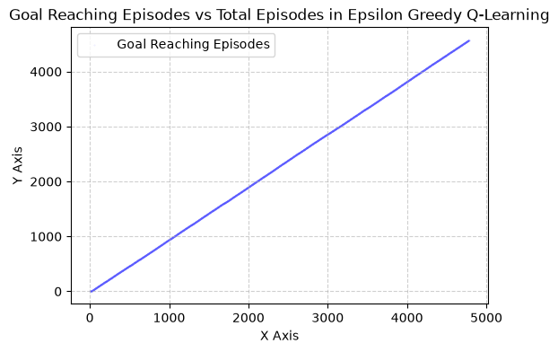
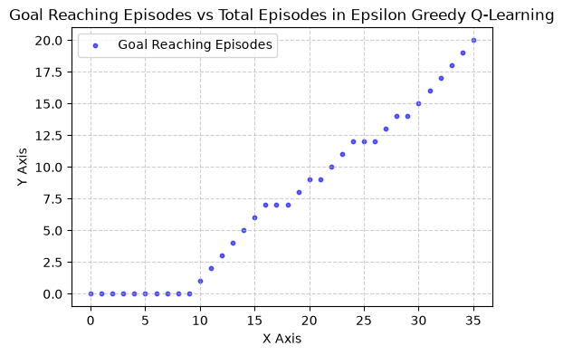
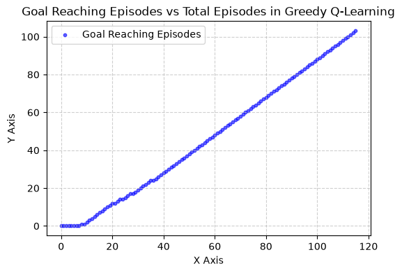

# LOGS

## 24th October - Commit 596ba4c

I expected much better results, hence something must be breaking

in a 5x5 GridWorld, the robot can't find the goal even after 1e5 steps. Not epochs, but steps, Its possible in one episode, the robot takes many steps before falling into the pit

In a 3x3 GridWorld, the robot finds the cells roughly 3% of the times in 100 steps, wiht improvement going upto 5% in 1e5 steps
But frankly once the robot smells the goal, tastes it, it should be super fast in reaching it I feel.

The environment state isnt given to the robot, it just fcks around and finds out

## Last commit

Amazing, i didn't update weights when I fell in a pit, or potentially reached goal

So the bellman optimality equation wasn't even being executed with negative rewards

ChangeLog

- Fixed Action Value Matrix updation andd reward system
- Added epsilon factor, which also adds exploration
- Added this beautiful plotter

  

  The closer this line is to y=x, the more it indicated that ever episode ended in a goal state
  (While this may look like a line, its actually a scatter plot with size 0.1 and alpha 0.1)

Issues

- Tie-breaking: argmax always favors 0 ("LEFT")
- Agent and Environment are fused :C

Epsilon is currently 5%
Alpha 0.1 and Gamma 0.8

As evident in this plot, after 10 episodes, the goal has been smelled, and once that happens, the algo knows what to do and where to go. I wouldnt say it completely converged, but it has reached an optimal policy I think. The small bumps occuring after episode 10 might be due to the 5% Epsilon.

But that is speculation, lemme check that, setting epsilon to 0

Yeah, after the 38th ish episode, optimal policy is found, and the robot just keeps following that
However good this may look, it's off-learning

My next move would be transitioning to SARSA
tbh when epsilon is 0, SARSA is Q-Learning

:P
